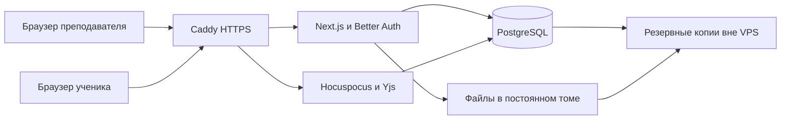

# Rimo: запуск для преподавателя и ученика

Проверено 25 октября 2026 года. Основной сценарий: один преподаватель и один ученик, затем больше учеников. Clerk и Liveblocks исключены из целевой архитектуры по требованию владельца.

**Разместить проект можно. Восстанавливать его для собственных занятий целесообразно. Текущее состояние нельзя открывать всем: есть ошибки доступа, сохранённый XSS и незащищённая загрузка файлов. Рекомендую сохранить свой редактор, заменить внешнюю инфраструктуру и начать с закрытого пилота.**

## Что фактически есть

Next.js 15.3.2, React 18.3.1, TypeScript, Tailwind 4. Реализованы фигуры, свободное рисование, текст, стикеры, изображения, карточки ссылок, курсоры участников, масштабирование, история изменений, список досок, поиск и избранное. Экспорт, полноценный мобильный режим и импорт Miro остаются задачами развития.

Данные распределены между тремя сервисами:

| Сервис | Его роль в текущем коде | Что нужно перенести |
|---|---|---|
| Clerk | Аккаунты, сессии, организации, приглашения, UI входа | Вход преподавателя, доступ учеников и серверные проверки |
| Convex | Названия/авторы досок, избранное, изображения | Небольшой CRUD API, таблицы и файловое хранилище |
| Liveblocks | Слои доски, их порядок, курсоры, выделения, синхронизация и undo/redo | Совместный документ, presence, история, сохранение и переподключение |

В собственном Docker-контейнере сейчас запускается только Next.js. Он не переносит остальные данные на свой сервер. В рабочем коде не найдены обращения к `DATABASE_URL` или `AITUNNEL_API_KEY`: наличие этих переменных в старом локальном окружении не означает, что нужна ещё одна БД или платный AI-сервис.

## Проверка воспроизводимости

Проверены старое окружение и отдельная копия исходников с зависимостями из lock-файла. В копии выполнено `npm ci --ignore-scripts --no-audit --no-fund`: установлено 741 пакетов. Install scripts намеренно не запускались; необходимые для выполненной сборки бинарные зависимости оказались доступны.

| Проверка | Результат |
|---|---|
| Production build | Проходит в обоих окружениях; lint отключён самим build-script |
| Vitest | 11 файлов, 29 тестов проходят и после чистой установки |
| Полный TypeScript | Две ошибки `Cannot find namespace 'vi'` в тесте fetch-link-preview, строки 22 и 42 |
| Lint исходников с ESLint из lock-файла | 71 ошибка, 14 предупреждений; в том числе нарушения порядка React hooks |
| Старый node_modules | Отличается от lock-файла; установлен ESLint 8 при заявленном 9, есть посторонние пакеты |
| Локальный production-сервер | После привязки к `localhost` главная страница и POST `/api/generate-cover` возвращают 200; лендинг отображается в браузере |
| Полный урок в двух браузерах | Не подтверждён: вход в аккаунт и настоящая совместная доска в этом аудите не проверялись |
| npm audit по lock-файлу | 85 уязвимых записей пакетов всего; для production-зависимостей 16: 3 critical, 11 high, 2 moderate |

Число записей npm audit не равно числу разных эксплуатируемых уязвимостей: учитываются транзитивные зависимости и особенности конфигурации. Однако старый Next.js требует обновления до поддерживаемой исправленной версии до публикации. В частности, установленная ветка попадает в диапазон официального предупреждения по RSC: [Next.js security advisory](https://nextjs.org/blog/CVE-2025-66478). Простое обновление до первого исторического исправления недостаточно: выбирать актуальный исправленный релиз на момент миграции.

Сборка сама по себе не доказывает исправность входа, внешних сервисов или совместного редактирования. Первый запуск на `127.0.0.1` дал зависание и `Failed to proxy ... localhost:3100 / ECONNREFUSED`. При повторном запуске с `--hostname localhost` запросы прошли и лендинг появился. Это локальная проблема привязки/проксирования, а не доказательство неисправности облачных аккаунтов. Браузер подтвердил загрузку Clerk с development keys; переносить такое окружение в production нельзя.

Для воспроизведения smoke-проверки: `npm run build`, затем `npm start -- --hostname localhost --port 3100`, открыть `http://localhost:3100`. Эти команды используют существующее локальное окружение и пока не реализуют замену Clerk/Liveblocks.

## Результат независимого ревью

Вердикт агента: полноценный прототип, который можно довести до эксплуатации. Основные проблемы — права доступа и надёжность данных. Переписывать весь визуальный редактор ради исправления этих проблем не требуется.

| Приоритет | Дефект и последствия | Точка в коде |
|---|---|---|
| До запуска | Изменение и удаление доски проверяют лишь факт входа; принадлежность организации не проверяется. Чужие доски доступны по известным ID; `get` вообще без входа | [board.ts](E:/projects/rimo/convex/board.ts:35), [boards.ts](E:/projects/rimo/convex/boards.ts:13), [board.get](E:/projects/rimo/convex/board.ts:151) |
| До запуска | Публичные Convex-функции позволяют анонимно получить upload URL и сохранить файл. Нет привязки к доске и квот; проверку Next.js можно обойти прямым вызовом backend | [images.ts](E:/projects/rimo/convex/images.ts:17), [upload-image](E:/projects/rimo/app/api/upload-image/route.ts:6) |
| До запуска | Текст из clipboard попадает в `ContentEditable html` без очистки. Вставленный HTML может исполниться у другого участника | [text.tsx](E:/projects/rimo/app/board/[boardId]/_components/text.tsx:39), [canvas.tsx](E:/projects/rimo/app/board/[boardId]/_components/canvas.tsx:1239) |
| До запуска | Сервер загружает URL для preview без достаточной DNS/IP-проверки, auth и rate limit. Домен, разрешающийся во внутренний адрес, создаёт SSRF-риск | [fetch-link-preview](E:/projects/rimo/app/api/fetch-link-preview/route.ts:13) |
| До упаковки | Нет `.dockerignore`; `COPY . .` включает env, .git и старый node_modules в image. `env_file` на runtime этого не исправляет | [Dockerfile](E:/projects/rimo/Dockerfile:7) |
| До реального урока | Clipboard изображения сначала сохраняет общий `blob:` URL, доступный лишь создавшему его браузеру. Другой участник может остаться с ошибкой даже после появления настоящего URL | [canvas.tsx](E:/projects/rimo/app/board/[boardId]/_components/canvas.tsx:973), [image.tsx](E:/projects/rimo/app/board/[boardId]/_components/image.tsx:49) |
| До реального урока | Удаление доски оставляет избранное других пользователей; `getAllOrThrow` затем роняет список | [board.ts](E:/projects/rimo/convex/board.ts:42), [boards.ts](E:/projects/rimo/convex/boards.ts:24) |
| После блокеров | Две одновременные загрузки одного изображения создают одинаковый SHA; последующий `.unique()` падает | [images.ts](E:/projects/rimo/convex/images.ts:10) |
| После блокеров | Глобальные copy/paste обработчики вмешиваются в input/contentEditable | [canvas.tsx](E:/projects/rimo/app/board/[boardId]/_components/canvas.tsx:1197) |
| После блокеров | `pointercancel` не возобновляет историю после `history.pause()` и не выполняет весь cleanup жеста | [canvas.tsx](E:/projects/rimo/app/board/[boardId]/_components/canvas.tsx:784) |

Важные уточнения: эксплуатация через реальные чужие аккаунты не проводилась. SSRF-цепочка проверялась агентом с подменой fetch, без запросов во внутреннюю сеть. Секрет Liveblocks ошибочно назван `NEXT_PUBLIC_LIVEBLOCKS_SECRET_KEY`, но поиск его фактического значения в 35 клиентских JS-файлах текущей production-сборки не нашёл совпадений. Поэтому утечка в браузер не объявляется подтверждённой. Переименование и исключение секретов из Docker всё равно необходимы, пока старый путь запуска существует.

`canvas.tsx` — 1416 строк, объединяет жесты, clipboard, загрузки, историю и интерфейс. Его следует разделить по ответственности при миграции. Тесты сейчас преимущественно проверяют утилиты и mock API; изоляцию досок, восстановление и синхронизацию они не защищают.

## Рекомендуемая архитектура

**Один VPS, Next.js, Better Auth, PostgreSQL, Yjs и Hocuspocus.** Clerk и Liveblocks убираются. Convex предлагаю тоже заменить: он обслуживает небольшой слой метаданных и файлов, а после появления своего WebSocket-сервера экономии на отсутствии VPS уже нет. Это рекомендация, удаление Convex ещё не выполнялось.

Better Auth имеет прямое подключение к PostgreSQL: [официальный адаптер](https://better-auth.com/docs/adapters/postgresql). Он заменяет внешний сервис входа библиотекой на своём сервере. Для пилота: аккаунт преподавателя и закрытая регистрация; ученику — отдельное отзываемое приглашение к конкретной доске. Возможность редактировать между занятиями уточняется завтра.

Yjs предоставляет совместные Map/Array и слияние изменений: [документация](https://docs.yjs.dev/). Hocuspocus — готовый WebSocket backend под MIT, который можно запускать у себя: [репозиторий](https://github.com/ueberdosis/hocuspocus). Подписка Tiptap Cloud для самостоятельного размещения не требуется. Переносится слой совместной работы; React/SVG-компоненты фигур и геометрические утилиты сохраняются.

| Сейчас | После миграции |
|---|---|
| LiveMap/LiveObject слоёв | Y.Map с полями слоёв |
| LiveList порядка слоёв | Y.Array ID с операциями, сохраняющими уникальность ID |
| Presence, курсоры и выделение | Awareness; временные данные не записываются в историю документа |
| Liveblocks history | Y.UndoManager с отслеживанием локальных действий и группировкой жестов |
| Liveblocks room auth | Серверная проверка доступа к boardId до открытия документа |
| Liveblocks persistence | Бинарное состояние Yjs в PostgreSQL, восстановление и контроль сохранения |
| Convex boards/favorites/images | Серверные маршруты Next.js и небольшие SQL-таблицы |

Поддержка selective undo подтверждена [Y.UndoManager](https://docs.yjs.dev/api/undo-manager). Сохранение бинарного состояния поддерживает [Hocuspocus Database extension](https://tiptap.dev/docs/hocuspocus/server/extensions/database). JSON нужен для переносимого экспорта, но не должен заменять сохранённое CRDT-состояние на каждом переподключении.

Схема доступа: владелец и участники доски, роли чтения/редактирования, отдельные приглашения. ID доски не является секретом доступа. Invite token хранится в БД как hash, может отзываться; при отзыве закрываются и действующие соединения. Нельзя просто снять Clerk middleware и оставить публичные API. Ограничения размера/частоты сообщений и загрузок нужны и в HTTP, и в WebSocket.

Для двух пользователей достаточно одного процесса совместной работы. Redis, Kubernetes, отдельный брокер и несколько серверов пока не нужны. При будущем добавлении нескольких WebSocket-процессов потребуется согласованное распределение комнат и синхронизация между процессами: запускать независимые копии с одним именем комнаты недостаточно.

## Стоимость

Главный платёж целевой схемы — VPS, а не плата за каждого ученика. Пример актуальной витрины [Beget VPS](https://beget.com/ru/vps): 2 vCPU / 2 ГБ / 30 ГБ — 27 ₽/день; 2 vCPU / 4 ГБ / 40 ГБ — 33 ₽/день. Публичный IPv4 — ещё 5 ₽/день; автоматические копии сервера включены.

| Вариант | Сервер и один IPv4 за 30 дней | Назначение |
|---|---:|---|
| 2 ГБ RAM | (27 + 5) × 30 = **960 ₽** | Минимальный пилот при сборке вне VPS |
| 4 ГБ RAM | (33 + 5) × 30 = **1140 ₽** | Предпочтительный старт с запасом для PostgreSQL и нескольких процессов |

За 31 день суммы будут 992 ₽ и 1178 ₽. Это расчёт по витрине, не подтверждённый заказ или минимальный первый платёж. Для планирования предлагаю **1500–2000 ₽/месяц**: 4 ГБ VPS, небольшой запас под внешние копии и рост файлов. Дополнительные 360–860 ₽ — бюджетный резерв, а не тариф Beget. Домен оплачивается отдельно после выбора имени; при существующем домене можно использовать поддомен. TLS-сертификат не требует платной подписки при использовании бесплатного ACME-провайдера.

Ресурсы — стартовая инженерная оценка, нагрузочный тест новой архитектуры ещё не выполнялся. 4 ГБ выбраны ради устойчивости и удобства, а не как доказанный минимум. Основной текущий документ ограничен 1000 слоями; это ограничение не гарантирует быстродействие на слабом устройстве.

Внешние копии нужны отдельно от автоматического backup сервера: дамп БД и файлы в другой системе хранения, регулярная проверка восстановления. На дешёвом старте это может быть зашифрованная копия на машине владельца. Серверный snapshot без проверки восстановления не равен гарантии сохранности уроков.

Для сравнения со старой схемой: [Liveblocks Free](https://liveblocks.io/docs/pricing/plans/free) даёт 3000 минут совместной работы и не больше 10 соединений в комнате. [Pro](https://liveblocks.io/docs/pricing/plans/pro) стоит $30/месяц или $25/месяц при оплате за год. Два человека по часу дважды в неделю за четыре недели — 960 participant-minutes. При выходе за бесплатный лимит потребуется платный тариф. Удаление Liveblocks избавляет от этой тарификации, но само по себе не означает экономию для двух человек: редкие занятия помещаются в Free.

Convex также имеет [бесплатный план](https://www.convex.dev/pricing). Следовательно, основная причина полного переноса — управляемость и отсутствие трёх внешних точек отказа, а не немедленная экономия на маленьком пилоте. У Vercel есть [Hobby для личного некоммерческого использования](https://vercel.com/docs/plans/hobby), однако для выбранной схемы один постоянный VPS проще распределённых функций и отдельного хранения состояния. Утверждение «Vercel вообще не поддерживает WebSocket» сейчас неверно: [поддержка заявлена в public beta](https://vercel.com/kb/guide/do-vercel-serverless-functions-support-websocket-connections); остаются ограничения длительности и разделение состояния между экземплярами.

## Какие зависимости убрать

В package.json 36 runtime- и 19 dev-зависимостей. Большая часть используется. Число пакетов в node_modules включает транзитивные и инструменты сборки: оно само по себе не доказывает плохой код и не определяет цену VPS.

| Действие | Пакеты и пояснение |
|---|---|
| Удалить вместе с неиспользуемым кодом | `usehooks-ts`; `react-day-picker` и `components/ui/calendar.tsx`; `next-themes` и неиспользуемый `components/ui/sonner.tsx`; неиспользуемый `image-upload.tsx` с ошибочным вызовом hook |
| Удалить после проверки tooling | `ts-node` не вызывается конфигурацией/скриптами; старые `@types/testing-library__react` дублируют типы современной testing-library |
| Исправить или удалить сломанный workflow | `i18next-parser`: скрипты ссылаются на отсутствующие `i18next-parser.config.js` и `scripts/translate_i18n.py`. Runtime-переводы от parser не зависят |
| Удалить при миграции | `@clerk/nextjs`, `@clerk/localizations`, три `@liveblocks/*`, затем `convex` и `convex-helpers` |
| Упростить при желании | `query-string` → URLSearchParams; `@uidotdev/usehooks` используется только для debounce; `date-fns` только для относительной даты; `typewriter-effect` — декоративный эффект |
| Пересмотреть ради безопасности | `react-contenteditable` → контролируемый plain text, если rich HTML не требуется; серверные link previews пока отключить и удалить `link-preview-js` |
| Оставить | React/React DOM, Next, Radix, Tailwind, утилиты классов, Lucide, perfect-freehand, тесты и TypeScript: они решают реальные задачи |

Нельзя автоматически удалить `motion` только потому, что прямого импорта нет: пять компонентов импортируют транзитивный `framer-motion`. Правильнее перейти на `motion/react` и оставить одну объявленную библиотеку либо убрать эти анимации. Аналогично прямой импорт `i18next` должен быть явно объявлен в package.json; сейчас разрешается транзитивно. `@clerk/clerk-react` также импортируется напрямую без декларации, но исчезнет с Clerk. React DOM нужен и без явного импорта. Типы React 19 следует согласовать с используемым React 18 при обновлении стека.

Чистая установка уже показала: часть «мусора» — следы старого node_modules, а не зависимости приложения. Обновлять lock-файл и выполнять контролируемый `npm ci` важнее ручного удаления случайных папок. Удаление мелких пакетов экономит поддержку и размер поставки; оно не обещает существенного уменьшения ежемесячной аренды.

## Порядок реализации и трудоёмкость

Рабочая оценка для одного разработчика, знакомого с React/TypeScript: **50–90 часов до проверенного закрытого пилота**, если старые облачные данные переносить не нужно. Это предварительная оценка, не фиксированная цена и не обещание выполнить миграцию за ночь.

1. **4–8 часов:** обновить уязвимые зависимости, согласовать tooling, исправить TypeScript/hooks, разделить будущую логику документа и UI; сохранить эталон текущего поведения.
2. **10–18 часов:** собственный вход, users/boards/members/invites, CRUD и права; заменить Clerk и Convex в интерфейсе/API. Проверить постороннего и удалённого участника.
3. **20–36 часов:** Yjs/Hocuspocus, слои и порядок, курсоры, gesture undo/redo, сохранение и восстановление; убрать Liveblocks из компонентов и hooks.
4. **8–16 часов:** безопасные изображения и clipboard, JSON export/import с версией формата и переносом вложений; исправить текстовый XSS.
5. **8–12 часов:** Docker Compose, HTTPS, постоянные тома, внешние копии и восстановление, проверки двумя браузерами и пробный урок.

Старые доски могут увеличить объём: Convex хранит метаданные/файлы, Liveblocks — сами слои. Нужны экспорт обоих источников, сопоставление старых Clerk user/org ID новым владельцам и проверка изображений. До решения владельца старые облачные данные не удалять.

Первый технический этап должен быть маленьким: отдельный эксперимент Yjs с двумя клиентами, перемещением фигуры, локальной отменой, перезапуском сервера и восстановлением. Если эти свойства не выдерживаются, остальной редактор ещё не переносить. Это снижает риск большой незаконченной переделки.

## Что выпускать и как развивать

Первый выпуск: аккаунт преподавателя, постоянная доска ученика, отзываемый доступ, рисование/текст/картинки, автосохранение, видимый статус соединения и сохранения, выгрузка и восстановление копии. Звонок остаётся во внешнем привычном приложении. Организации и корпоративные приглашения не нужны.

Критерий готовности: оба клиента видят одинаковый результат, обновление страницы и краткий обрыв не теряют материал, перезапуск сервера восстанавливает доску, отмена действий преподавателя не отменяет чужие действия, чужой пользователь не читает доску, картинка доступна обоим после повторного открытия, копия реально восстанавливается.

После 3–5 настоящих занятий добавить только то, что мешает преподаванию: список учеников и материалов, дубликаты заданий, домашнюю работу и режим просмотра, простой экспорт PNG/PDF. Математические формулы, код или геометрические инструменты выбирать после уточнения предмета. Полная мобильная поддержка зависит от используемых устройств.

Пока отложить оплату, AI, видеозвонки внутри Rimo, импорт Miro, корпоративные интеграции, большую библиотеку шаблонов и масштабирование на несколько узлов. Отдельно исправить обещание лендинга «без ограничений»: в коде есть лимит 1000 слоёв.

Как бизнес «ещё одна универсальная доска» требует отдельного доказательства спроса: у [Miro есть Free с тремя редактируемыми досками](https://miro.com/pricing/), а [Excalidraw открыт под MIT](https://github.com/excalidraw/excalidraw). Для собственного преподавания уже существует конкретный пользователь и польза. Если цель — только получить готовую доску как можно быстрее, существующий инструмент дешевле по времени. Если нужны свой процесс занятий и дальнейшее развитие продукта, восстановление Rimo оправдано при ограниченном объёме пилота.

## Состояние после аудита

Исходники приложения, package.json, lock-файл и исходное окружение не изменялись. Сохранены исходные пользовательские изменения лендинга. Платные ресурсы не заказывались, проект не публиковался. Отдельные агенты выполнили кодовое ревью и продуктовый анализ. Материалы обсуждения находятся рядом: [вопросы на завтра](E:/projects/rimo/plan/questions-for-tomorrow-2026-10-25.md).
