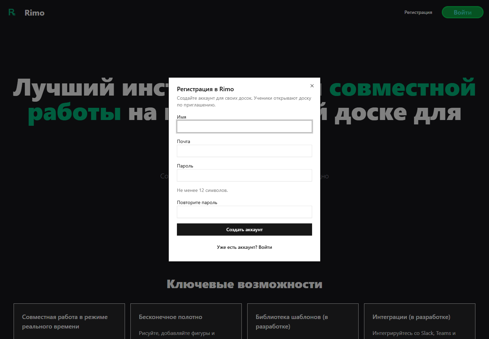

# Исправление самостоятельной регистрации

## Требование

28 октября владелец попросил добавить регистрацию в Rimo: сейчас доступен
только вход, создание аккаунтов возможно лишь через CLI. Новое указание меняет
прежний режим приглашённых владельцев. Существующий визуал сохраняется.
Панель прогресса остаётся закрытой; её входящие проверяются только во время
активной работы в этом чате, согласно ответу владельца.

## План

- [x] Найти причину отсутствия UI/API регистрации.
- [x] Добавить форму регистрации и переключение на вход.
- [x] Разрешить API с прежними квотами, валидацией и защитой Origin/rate limit.
- [x] Проверить новый аккаунт, повторный вход, свои доски и отсутствие чужого доступа.
- [x] Независимое ревью, коммит, GitHub/CI и обновление сервера с резервной копией.
- [x] Проверить публичный браузерный сценарий на установленной сборке.

## Найдено

В прежней версии `server/auth.ts` создавал штатный Better Auth с
`disableSignUp: true`, а `components/auth/sign-in-button.tsx` содержал только вход.
Теперь общий `AuthButton` поддерживает оба режима; публичный signup использует
существующую защиту `withOwnerQuota`, включая конкурентное создание аккаунтов.

## Локальные проверки

- 7 компонентных тестов формы и35 серверных интеграционных проверок прошли.
- ESLint и общий typecheck прошли; независимое source review — без открытых P0–P2.
- Регистрационный E2E добавлен в local/CI: новый аккаунт, своя доска, чужая404,
  выход и повторный вход. Trace с паролем отключён; cleanup только по
  подтверждённым id/email/name. Внешний режим не получает доступ к production БД.
- Первая DB-попытка проверок упёрлась в штатные3запроса/10с с одного IP.
  Независимые тесты получили разные synthetic IP; отдельный сценарий подтвердил
  429. Производственный rate limit не ослаблялся.
- При ревью исправлены2 замечания к cleanup E2E: запрещено удаление без
  подтверждённого ID, операции уборки выполняются независимо.

## Что работает на сайте

На [rimo-whiteboard.ru](https://rimo-whiteboard.ru) нажмите **«Регистрация»**
вверху или **«Попробовать бесплатно»**. Укажите имя, почту и пароль от12символов,
повторите пароль и нажмите **«Создать аккаунт»**. Откроются свои доски.
Ссылка **«Уже есть аккаунт? Войти»** переключает форму на обычный вход.

[Снимок на узком экране375px](registration-fix-2026-10-28/registration-mobile.png).
Дождались окончания анимации открытия: форма непрозрачна, кнопка видна во viewport.

## Развёртывание и приёмка

Код сохранён в371d207 и прошёл [полный CI](https://github.com/dedbin/rimo/actions/runs/40650916690),
включая регистрационный браузерный test. [Установленный релиз](registration-fix-2026-10-28/release-proof.json)
собран из того же commit; перед переключением выполнена свежая штатная
зашифрованная копия, предыдущий релиз сохранён, постоянные volumes не изменились.

[Публичная регистрация](registration-fix-2026-10-28/public-proof.json) проверена
настоящим браузером по HTTPS: новый аккаунт, автоматический вход, своя доска,
выход/повторный вход и сохранность доски. Свой тестовый аккаунт удалён только
после точного совпадения id/email/name и удаления его доски. Временный пароль
удалён локально; чужие аккаунты и доски не затрагивались.

На новой версии также прошли5 прежних публичных E2E за59с: совместная работа,
права/отзыв, изображения/clipboard, rich text/math, PDF и архивы. Регистрационный
test основной suite штатно пропущен во внешнем режиме, поскольку требует
локальную БД для cleanup; его заменяет отдельная публичная проверка выше.
