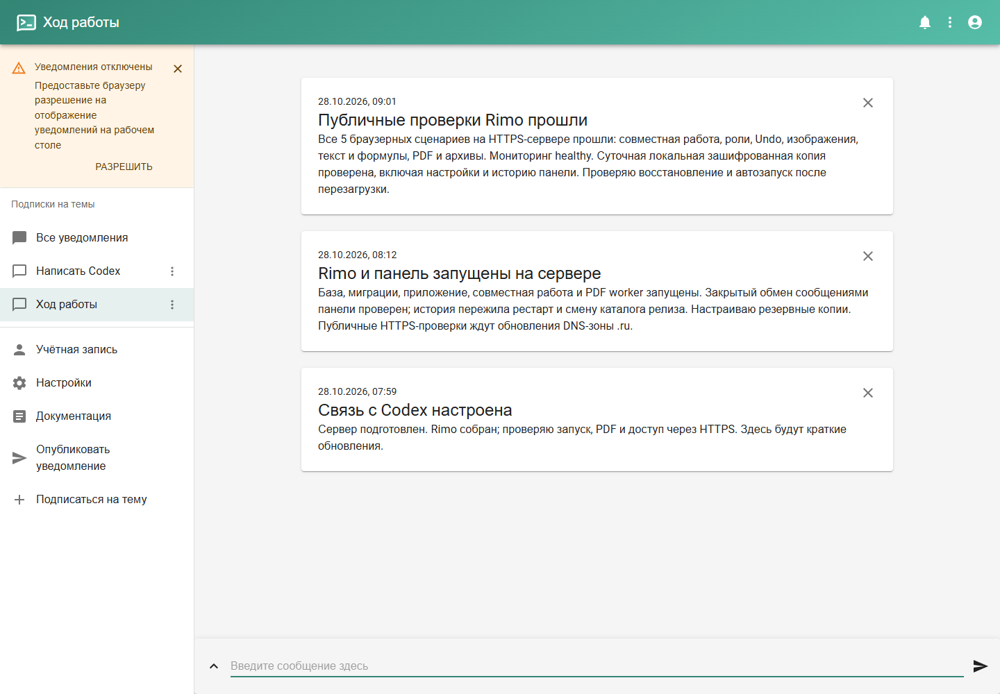

# Как пользоваться панелью Rimo

Панель уже работает: [открыть](https://www.rimo-whiteboard.ru:8443).
Сам Rimo: [rimo-whiteboard.ru](https://rimo-whiteboard.ru).

## Вход

Логин панели — `owner`. Пароль находится на вашем компьютере в
`E:\projects\rimo\.env.server-accounts`, строка `DASHBOARD_PASSWORD`.
Пароль от Rimo записан отдельно в том же файле: `RIMO_OWNER_PASSWORD`.

## Где смотреть и писать

В меню слева выберите **«Ход работы»**, чтобы прочитать короткие обновления.
Для своего сообщения выберите **«Написать Codex»**, введите текст внизу
и нажмите **Enter** или стрелку справа. Ответ появится в «Ход работы».
Ваше реальное сообщение из панели уже получено и обработано.

Снимок сделан во время развёртывания; новые записи появляются сверху.
Разрешать браузерные уведомления для чтения и отправки сообщений необязательно.

## Что уже проверено

- HTTPS и вход работают; посторонний не может читать приватные каналы.
- Совместное редактирование, сохранение, изображения, текст/формулы,
  PDF и архивы прошли пять браузерных сценариев на этом сервере.
- Резервная копия восстановилась отдельно; рабочие данные при этом не менялись.
- После перезагрузки сервер сам поднял Rimo и панель. Вход и сообщения сохранились.
- Копирование назначено ежедневно на 04:00 по Москве.

Можно начать с пробного занятия под вашим наблюдением. Для решения о постоянном
использовании ещё нужны реальные занятия, нагрузочная приёмка и внешняя копия.

## Когда Codex видит сообщение

Пока я проверяю панель во время активной работы в этом чате. Отправленное
сообщение сохраняется на сервере, но само по себе не запускает новый ответ Codex.
По вашему выбору проверка выполняется только во время работы в этом чате;
регулярного фонового задания нет.
Пароли и другие секреты лучше передавать через приватный файл доступа.
